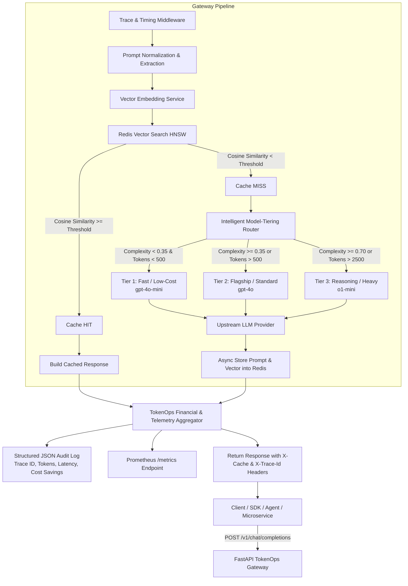

# Enterprise LLM Semantic Caching & TokenOps Gateway

[](https://www.python.org/)
[](https://fastapi.tiangolo.com/)
[-DC382D.svg)](https://redis.io/)
[](https://www.docker.com/)
[](https://platform.openai.com/)

A production-grade, enterprise-ready **LLM Semantic Caching & TokenOps Gateway** built with Python 3.11+ and FastAPI. The gateway intercepts inbound LLM requests, evaluates prompt semantic similarity against Redis Vector Search using cosine distance, dynamically routes un-cached traffic across intelligent model tiers based on token length and prompt complexity, and outputs high-fidelity structured JSON logs for comprehensive cost and token observability.

---

## What the System Is
The **TokenOps Gateway** is an enterprise AI infrastructure reverse-proxy that sits between client applications (agents, microservices, LangChain/LlamaIndex pipelines, OpenAI SDKs) and upstream LLM providers. Instead of blindly sending every prompt to expensive flagship models, it provides:
1. **Semantic Vector Caching**: Eliminates redundant LLM API calls by serving semantically identical or near-identical prompts directly from Redis memory in sub-3ms latency.
2. **Intelligent Model-Tiering**: Inspects incoming prompts for code syntax, analytical reasoning, and token length, automatically dispatching requests to the most cost-effective model tier.
3. **TokenOps Financial Observability**: Tracks every token, latency stage, and dollar saved in structured JSON logs and Prometheus metrics.
4. **Interactive Cockpit**: Provides a built-in dark glassmorphism UI dashboard for developers to test, inspect, and monitor gateway operations.

---

## What the System Does
- ⚡ **Sub-3ms Cache Hits**: Generates 1536-dimensional float32 vector embeddings and runs HNSW cosine similarity search on Redis Stack. If $\text{cosine similarity} \ge 0.88$, upstream LLM calls are completely bypassed ($0 cost, 95% latency reduction).
- 🔀 **Multi-Signal Complexity Routing**: Analyzes code density, mathematical deduction markers, and token volumes, routing to **Tier 1** (`gpt-4o-mini`), **Tier 2** (`gpt-4o`), or **Tier 3** (`o1-mini`), saving up to 94% on simple queries.
- 📊 **Structured JSON Audit Logs**: Emits single-line JSON log lines tracking `trace_id`, latency breakdown (`embedding_ms`, `cache_lookup_ms`, `upstream_llm_ms`), tokens saved, and cost saved.
- 📈 **Prometheus Telemetry**: Real-time counters and latency histograms exported at `/metrics`.
- 💻 **Interactive Playground & Inspector**: Web dashboard at `http://localhost:8000/` to test prompts, inspect nearest vector neighbors, and purge cache.

---

## Architecture Overview



---

## Key Features

### 1. Redis Vector Search Semantic Caching (Async Ingestion)
- **HNSW Indexing**: Uses Hierarchical Navigable Small World (HNSW) graph indexing with `FLOAT32` vectors and `COSINE` distance metric in RediSearch.
- **Cosine Similarity Formulation**:
  $$\text{Cosine Similarity} = 1.0 - \text{Redis Vector Distance}$$
- **Threshold Matching**: Prompts with $\text{similarity} \ge \tau$ (default $\tau = 0.88$) return cached completions sub-millisecond, bypassing upstream LLM APIs entirely.
- **Resilient Fallback**: Graceful in-memory vector fallback when connecting to bare Redis instances without RediSearch modules.
- **Configurable TTL**: Cache records automatically expire after `CACHE_TTL_SECONDS` (default: 24h).

### 2. Intelligent Model-Tiering Router
Intercepts prompts, analyzes semantic signals, and dynamically routes requests into optimal model tiers:
- **Signal 1: Code & Syntax Density (Weight 0.35)**: Detects code blocks, indentation, function definitions (`def`, `class`, `SELECT`, `async`), syntax operators, and stack traces.
- **Signal 2: Multi-Step Reasoning & Logic (Weight 0.30)**: Detects indicators like "step by step", "mathematical proof", "derive", "root cause analysis", and algorithmic trade-offs.
- **Signal 3: Enterprise Domain Terminology (Weight 0.20)**: Detects specialized technical vocabulary (Kubernetes, distributed consensus, cryptography, HIPAA/GDPR compliance).
- **Signal 4: Lexical & Structural Diversity (Weight 0.15)**: Analyzes type-token ratios and sentence structural complexity.

#### Tiering Matrix
| Tier | Model | Trigger Criteria | Use Case |
| :--- | :--- | :--- | :--- |
| **Tier 1** | `gpt-4o-mini` | Tokens $\le 500$ and Complexity $< 0.35$ | Factual Q&A, short chat, low latency, >90% cheaper |
| **Tier 2** | `gpt-4o` | Tokens $\in (500, 2500]$ or Complexity $\in [0.35, 0.70)$ | Code debugging, business logic, general synthesis |
| **Tier 3** | `o1-mini` | Tokens $> 2500$ or Complexity $\ge 0.70$ | Deep multi-step reasoning, mathematical proof, massive context |

### 3. Structured JSON Logging & TokenOps Observability
Every request emits a canonical single-line JSON log record to `stdout` compatible with Datadog, Elasticsearch, Splunk, and CloudWatch:
```json
{
  "timestamp": "2026-10-17T11:05:22.148291+00:00",
  "level": "INFO",
  "logger": "tokenops_gateway",
  "message": "TokenOps request completed: cache_hit=true routed=gpt-4o-mini saved_usd=$0.002875",
  "trace_id": "4e75a9b2-06b2-4d7a-b9c1-197171d73981",
  "request_id": "c1f72a44-8df6-4ce5-8c77-4fbc265e3170",
  "tokenops": {
    "event_type": "llm_request_audit",
    "endpoint": "/v1/chat/completions",
    "status_code": 200,
    "model_requested": null,
    "model_routed": "gpt-4o-mini",
    "model_tier": 1,
    "cache_hit": true,
    "similarity_score": 0.9412,
    "tokens": {
      "prompt": 120,
      "completion": 85,
      "total": 205,
      "saved": 205
    },
    "financials": {
      "actual_cost_usd": 0.0,
      "baseline_cost_usd": 0.002875,
      "cost_saved_usd": 0.002875
    },
    "latency_ms": {
      "embedding_ms": 2.1,
      "cache_lookup_ms": 1.4,
      "upstream_llm_ms": 0.0,
      "total_gateway_ms": 3.5
    },
    "routing": {
      "complexity_score": 0.12,
      "reason": "Semantic Cache Hit"
    }
  }
}
```

### 4. Prometheus Metrics Exposition
Exported on `/metrics`:
- `tokenops_requests_total{endpoint, model_routed, cache_hit}`
- `tokenops_tokens_total{model_routed, token_type}`
- `tokenops_tokens_saved_total`
- `tokenops_cost_incurred_usd_total{model_routed}`
- `tokenops_cost_saved_usd_total`
- `tokenops_gateway_latency_seconds{stage, cache_hit}`
- `tokenops_cache_hit_ratio`

### 5. Interactive TokenOps & Semantic Caching Web Cockpit
Served natively at `http://localhost:8000/` and `/dashboard`:
- **Interactive Prompt Console**: Live testing of semantic cache hits, cosine similarity thresholds, and tier overrides.
- **Real-Time KPI Cards**: Dynamic monitoring of cache hit ratio, cost savings ($), tokens saved, and tier distributions.
- **Vector Inspector & Cache Admin**: Search nearest neighbors directly in the Redis vector index and trigger cache purges.
- **Telemetry & Latency Gauges**: Instant visual feedback of embedding time, vector lookup time, and upstream LLM time.

---

## Documentation Guides
- 🚀 **[Run & Deployment Guide](file:///c:/Users/HP/Documents/Exquisapps/ID's/lekeOmotayo/kilo/RUN.md)**: Complete step-by-step instructions for running locally, Docker Compose setup, and production Kubernetes/Cloud deployment.
- 📖 **[API Documentation](file:///c:/Users/HP/Documents/Exquisapps/ID's/lekeOmotayo/kilo/API_DOCUMENTATION.md)**: Exhaustive endpoint documentation with request/response schemas, headers, and SDK examples.

---

## Directory Layout

```
.
├── app/
│   ├── __init__.py
│   ├── main.py                  # FastAPI factory, ASGI entrypoint, middleware
│   ├── static/                  # Interactive Web Dashboard Cockpit (HTML/CSS/JS)
│   │   ├── index.html
│   │   ├── css/style.css
│   │   └── js/app.js
│   ├── core/
│   │   ├── config.py            # Pydantic BaseSettings with environment overrides
│   │   ├── logging.py           # Structured JSON formatter & TokenOps logger
│   │   └── pricing.py           # Per-model pricing tables & financial calculators
│   ├── models/
│   │   └── schemas.py           # OpenAI-compatible & TokenOps Pydantic models
│   ├── services/
│   │   ├── embeddings.py        # Async OpenAI & deterministic vector embedding engine
│   │   ├── cache.py             # Redis Vector Search (RediSearch) HNSW client
│   │   ├── router.py            # Multi-signal complexity & length routing engine
│   │   ├── llm_client.py        # Resilient upstream client with mock/prod execution
│   │   └── tokenops.py          # Prometheus registry & financial aggregator
│   └── api/
│       └── v1/
│           ├── router.py        # API router aggregation
│           └── endpoints/
│               ├── chat.py      # /v1/chat/completions & /v1/generate
│               ├── cache_admin.py # /v1/cache/stats, /purge, /inspect
│               ├── tokenops_admin.py # /v1/tokenops/summary, /models, /metrics
│               └── health.py    # /health & /ready probes
├── tests/
│   ├── conftest.py              # Test harness & cache isolation fixtures
│   ├── test_embeddings.py       # Unit tests for vector generation and cosine math
│   ├── test_cache.py            # Unit tests for RediSearch similarity & TTL
│   ├── test_router.py           # Unit tests for model-tiering & complexity scoring
│   ├── test_tokenops.py         # Unit tests for pricing formulas & aggregator
│   ├── test_logging.py          # Unit tests for JSON structured log schemas
│   ├── test_api_chat.py         # Integration tests for OpenAI chat completions
│   └── test_api_admin.py        # Integration tests for admin, health & UI dashboard
├── Dockerfile                   # Multi-stage, non-root hardened container image
├── docker-compose.yml           # Redis Stack + TokenOps Gateway orchestrator
├── requirements.txt             # Core production dependencies
├── requirements-dev.txt         # Dev, linting, and testing dependencies
├── pytest.ini                   # Pytest async runner configuration
├── .env.example                 # Fully documented environment template
├── RUN.md                       # Comprehensive Run & Deployment Guide
├── API_DOCUMENTATION.md         # Exhaustive API reference documentation
└── README.md                    # System architecture and overview
```

---

## Quickstart

### Option 1: Docker Compose (Recommended)

1. Clone or navigate to the repository directory.
2. Launch the gateway and Redis Stack with a single command:
```bash
docker compose up --build
```
3. Services available:
   - **TokenOps Gateway**: `http://localhost:8000`
   - **Swagger UI**: `http://localhost:8000/docs`
   - **Prometheus Metrics**: `http://localhost:8000/metrics`
   - **RedisInsight GUI**: `http://localhost:8001`

---

### Option 2: Local Python Environment

1. Create and activate a Python 3.11+ virtual environment:
```bash
python -m venv .venv
# On Linux/macOS:
source .venv/bin/activate
# On Windows:
.venv\Scripts\activate
```

2. Install dependencies:
```bash
pip install -r requirements-dev.txt
```

3. Run the development server:
```bash
uvicorn app.main:app --host 0.0.0.0 --port 8000 --reload
```

---

## API Reference & Usage

### 1. Chat Completion (OpenAI Drop-In)
```bash
curl -X POST http://localhost:8000/v1/chat/completions \
  -H "Content-Type: application/json" \
  -H "X-Trace-Id: trace-enterprise-101" \
  -d '{
    "messages": [
      {"role": "user", "content": "What is the capital of France?"}
    ],
    "temperature": 0.7
  }'
```

**Response Headers**:
- `X-Cache: HIT` (or `MISS`)
- `X-Similarity-Score: 0.9412` (on HIT)
- `X-Routed-Model: gpt-4o-mini`
- `X-Tier: 1`
- `X-Trace-Id: trace-enterprise-101`
- `X-Latency-Ms: 3.45`

---

### 2. Bypass Cache Execution
Enforce a fresh upstream call by setting `"bypass_cache": true`:
```bash
curl -X POST http://localhost:8000/v1/chat/completions \
  -H "Content-Type: application/json" \
  -d '{
    "messages": [{"role": "user", "content": "What is the capital of France?"}],
    "bypass_cache": true
  }'
```

---

### 3. Enforce Specific Tier Override
Force a query to a specific tier (1, 2, or 3):
```bash
curl -X POST http://localhost:8000/v1/chat/completions \
  -H "Content-Type: application/json" \
  -d '{
    "messages": [{"role": "user", "content": "Quick question"}],
    "force_tier": 3
  }'
```

---

### 4. Inspect Semantic Cache Nearest Neighbors
Audit vector similarity for incoming prompts:
```bash
curl -X POST http://localhost:8000/v1/cache/inspect \
  -H "Content-Type: application/json" \
  -d '{
    "prompt": "What is the capital city of France?",
    "top_k": 3
  }'
```

---

### 5. TokenOps Financial Summary
```bash
curl -X GET http://localhost:8000/v1/tokenops/summary
```
**Sample Output**:
```json
{
  "total_requests": 1420,
  "cache_hits": 890,
  "cache_misses": 530,
  "cache_hit_ratio": 0.6268,
  "total_tokens_processed": 1450200,
  "tokens_saved_by_cache": 912400,
  "total_spend_usd": 1.3412,
  "total_savings_usd": 7.4520,
  "savings_percentage": 84.75,
  "tier_distribution": {
    "tier_1": 420,
    "tier_2": 85,
    "tier_3": 25
  }
}
```

---

## Running Test Suites

Run the complete test suite with coverage:
```bash
pytest
```

To run a specific test domain:
```bash
# Model router tests
pytest tests/test_router.py

# Semantic vector cache tests
pytest tests/test_cache.py

# Structured JSON logging tests
pytest tests/test_logging.py

# End-to-end API integration tests
pytest tests/test_api_chat.py
```

---

## Production Security & Deployment Notes
1. **Non-Root Execution**: Container runs under dedicated user `appuser` (UID 10001).
2. **Fail-Open Semantic Caching**: If Redis encounters network partitions, the gateway gracefully fails open to ensure 99.99% availability for upstream LLM traffic.
3. **Trace Context Propagation**: Compliant with distributed tracing standards via `X-Trace-Id` headers.
4. **Zero-Trust Input Validation**: Pydantic v2 schemas enforce validation on all inputs and prevent prompt injection into Redis search queries.

---

## 🎨 Interactive Web Cockpit & Frontend Dashboard

The TokenOps Gateway features a built-in dark glassmorphism web console served directly at `http://localhost:8000/` (or your deployed Render URL):

- **Live Chat Completions Playground**: Test prompts, inspect real-time cache hits vs misses, and examine model tier routing decisions (`gpt-4o-mini`, `gpt-4o`, `o1-mini`).
- **Nearest Neighbors Vector Inspector**: Search Redis HNSW vectors for any arbitrary prompt and view cosine similarity scores in real-time.
- **Cache Management**: One-click flush and TTL inspector.
- **TokenOps Financial Telemetry**: Live metrics on tokens processed, tokens saved by cache, and financial savings calculated.

---

## 🚀 How to Deploy on Render

Kilo is ready for instant deployment on [Render](https://render.com) using either the automated Blueprint or manual dashboard setup.

### Option 1: One-Click Render Blueprint (Recommended)

Kilo includes a production-ready `render.yaml` blueprint defining the FastAPI Web Service and a private Redis instance.

1. Push your repository to GitHub or GitLab.
2. Go to the [Render Dashboard](https://dashboard.render.com/) and click **Blueprints > New Blueprint Instance**.
3. Select your repository containing Kilo.
4. Render will parse `render.yaml` and prompt you for the `OPENAI_API_KEY` secret.
5. Click **Apply**. Render will automatically provision:
   - A managed Redis Stack instance (`kilo-redis`)
   - The containerized FastAPI service (`kilo-tokenops-gateway`) connected via private networking
6. Once deployed, open your service URL (e.g. `https://kilo-tokenops-gateway.onrender.com/`) to access the live web console.

### Option 2: Manual Web Service Deployment on Render

If configuring services individually via the Render UI:

1. **Deploy Redis**:
   - In Render Dashboard, click **New + > Redis**.
   - Name: `kilo-redis`, Region: `Oregon` (or matching web service).
   - Once provisioned, copy the **Internal Redis URL** (`redis://red-...:6379`).

2. **Deploy FastAPI Web Service**:
   - Click **New + > Web Service**.
   - Select your Git repository.
   - **Environment**: `Docker` (Render automatically uses the multi-stage `Dockerfile`).
   - **Instance Type**: Free or Starter.
   - **Health Check Path**: `/health`.

3. **Configure Environment Variables**:
   Under the service **Environment** tab, add:
   | Key | Value | Description |
   | :--- | :--- | :--- |
   | `APP_ENV` | `production` | Production environment flag |
   | `PORT` | `8000` | Port listened by Uvicorn |
   | `HOST` | `0.0.0.0` | Bind address |
   | `REDIS_URL` | `redis://...` | Internal Redis connection string |
   | `OPENAI_API_KEY` | `sk-...` | Upstream OpenAI API Key |
   | `SIMILARITY_THRESHOLD` | `0.88` | Cosine similarity threshold for cache hit |
   | `CACHE_TTL_SECONDS` | `86400` | 24-hour cache entry time-to-live |

4. Click **Create Web Service**. Once the build succeeds, verify by visiting `https://<your-render-url>/health` and open the root URL for the developer dashboard.

